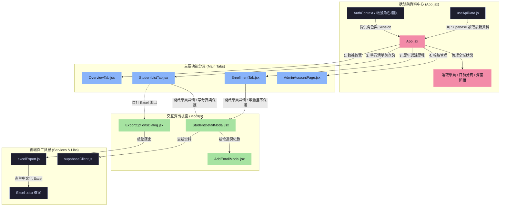
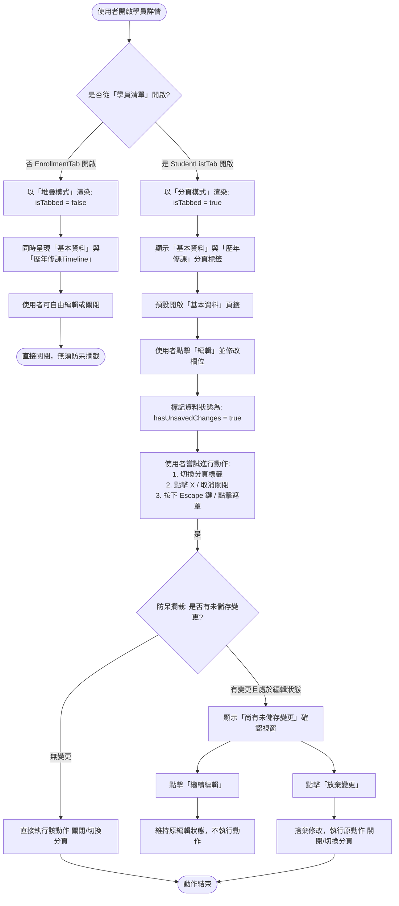
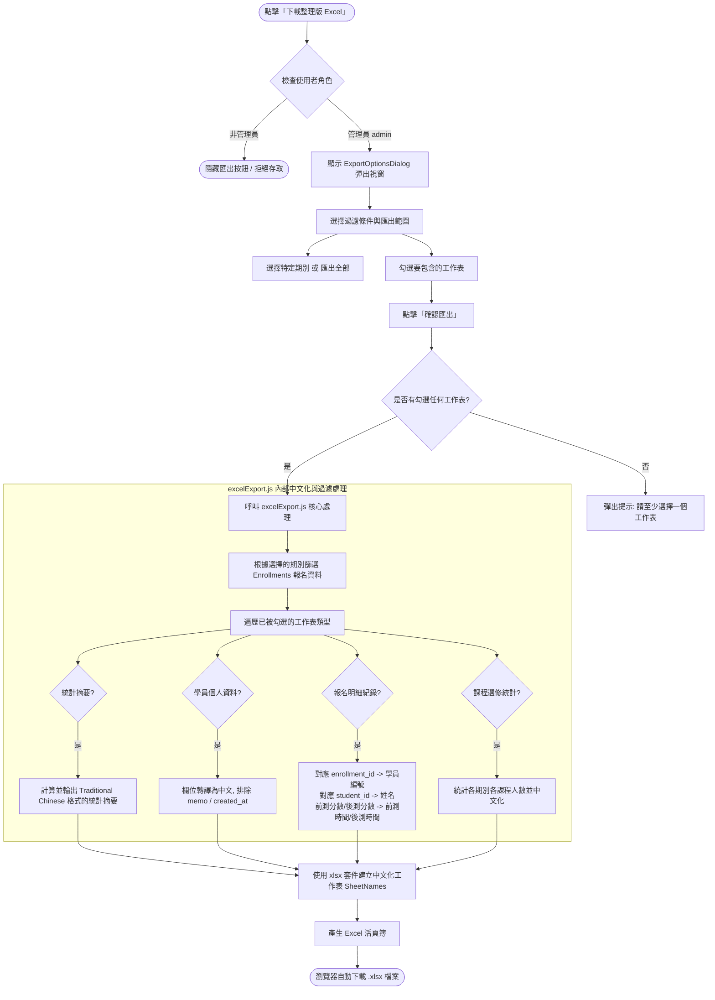

# YMCA 學員資訊管理系統 - 系統架構與業務邏輯架構圖

本文件包含本系統核心功能（系統組件架構、學員詳情模態框與 Excel 匯出）的流程架構與業務邏輯圖。

---

## 1. 系統組件與資料流架構圖 (System Architecture)

此圖展示了前端 React 應用的階層結構、狀態中心（App.jsx）、API 資料流向以及不同分頁與彈窗之間的交互關係。

---

## 2. 業務邏輯流程圖一：學員詳情檢視與編輯保護 (Edit Protection Flow)

此圖展示了當使用者在**「學員清單與查詢」**中開啟學員時，編輯保護機制是如何防範未儲存資料遺失的業務邏輯。

---

## 3. 業務邏輯流程圖二：客製化 Excel 活頁簿匯出與中文化 (Excel Export Flow)

此圖展示了管理員在進行 **Excel 匯出**時，系統如何處理期別過濾、工作表選擇以及後端中文化欄位對照的業務流程。

