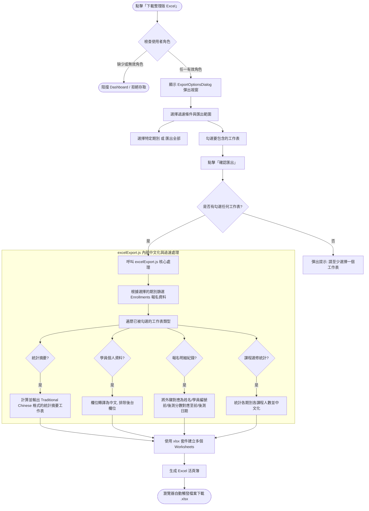
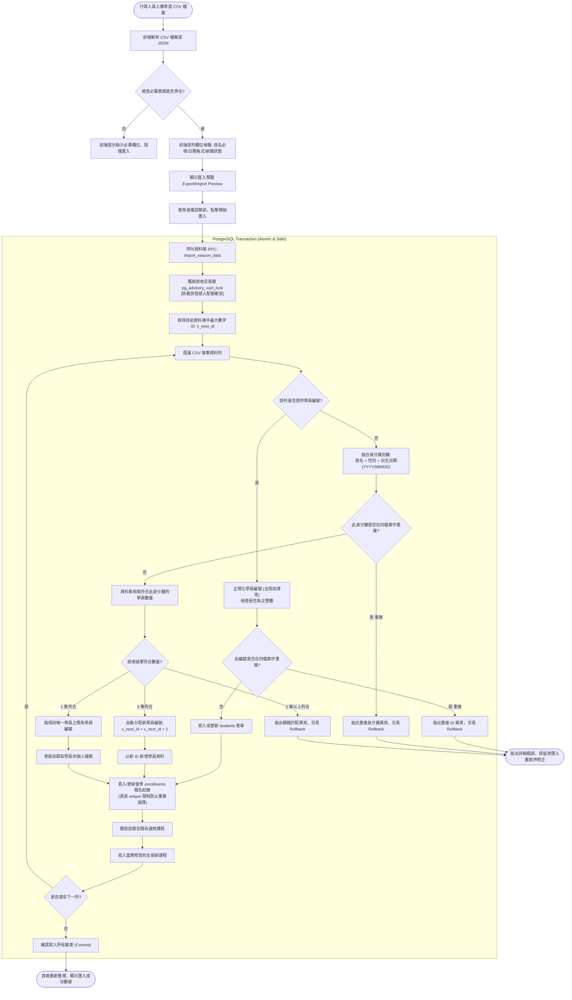

# YMCA 學員資訊管理系統 - 技術選型、系統架構與業務邏輯說明書

本文件詳細闡述本系統的技術選型與原因、整體軟體架構、資料流，以及核心業務邏輯的實作細節，並附帶對應的 Mermaid 流程與結構圖。

---

## 一、 技術選型與原因分析 (Tech Stack Selection & Rationale)

本系統作為 YMCA社教學員資料庫內部行政後台，主要處理學員資料、歷年選課紀錄追蹤及數據分析。在技術選型上，首要考量為**高開發效率、系統穩定性、低營運維護成本與強資料一致性**。

| 層級 (Layer) | 選用技術 (Selected Technology) | 選定原因與商業價值 (Rationale & Value) |
| :--- | :--- | :--- |
| **前端框架** | **React 19 + Vite 8** | 1. **React 19** 提供了更精簡的渲染與 API。單頁應用程式 (SPA) 的架構能提供極佳的行政人員操作體驗。 2. **Vite 8** 作為建置工具，具備極速的熱模組替換 (HMR) 與開箱即用的 ESM 支援，大幅提升本機開發與測試的速度。 |
| **樣式與 UI** | **Tailwind CSS 3 + Base UI + shadcn/ui** | 1. **Tailwind CSS** 提供原子化類別，便於微調 UI 並減少編譯後的 CSS 體積。 2. **Base UI / shadcn/ui** 提供無樣式、符合無障礙規範 (ARIA) 的基礎元件（例如對話框、選單），確保鍵盤操作與螢幕閱讀器友善，同時保有高度 CSS 自訂靈活度。 |
| **圖示與字型** | **Lucide React + Geist Variable Font** | Lucide 提供統一的 SVG 圖示集；Geist Variable 字型（透過 `@fontsource-variable/geist`）提供清晰的無襯線閱讀體驗，不依賴外部 CDN。 |
| **後端與資料庫** | **Supabase (PostgreSQL / Auth / Edge Functions)** | 1. **PostgreSQL** 具備強大的關聯式資料庫約束（Foreign Keys, Unique Constraints），完美保障學員與選課的關聯一致性。 2. **Supabase Auth** 提供現成的使用者認證，結合 PostgreSQL 的 **Row Level Security (RLS)** 機制，可直接在資料庫層限制不同角色的讀寫權限（`admin`, `editor`, `viewer`）。 3. **Edge Functions (Deno)** 可用於執行特權管理邏輯，如 admin 的帳號邀請、刪除與稽核日誌記錄，無須維護笨重的後端伺服器，大幅降低維運開銷。 |
| **資料處理** | **SheetJS (xlsx)** | YMCA 的原始學員報名資料多以 Excel 儲存。採用 **SheetJS** 可以在前端直接解析上傳的 Excel/CSV 檔案，並在本地端將複雜關聯資料（統計、個人資料、選課歷史）直接封裝成包含多個工作表 (Sheets) 的 Excel 檔下載，減少伺服器運算負載。 |
| **對話框** | **SweetAlert2** | 搭配 `sweetalert2-react-content`，用於顯示操作確認、成功/錯誤通知等互動式彈出提示，比原生 `window.confirm` 提供更好的 UX。 |
| **Markdown 渲染** | **react-markdown** | 用於 `FaqTab` 疑難雜症分頁，將內嵌的 Markdown 格式文件渲染為可閱讀的 HTML 介面。 |
| **自動化測試** | **Vitest + React Testing Library** | 1. **Vitest** 深度整合 Vite，共用相同的配置檔與編譯器，執行單元測試速度極快。 2. **React Testing Library** 著重於使用者行為的測試而非內部實作，結合 jsdom 模擬瀏覽器環境，保障前端 UI 邏輯與 API 服務的正確性（本專案已包含 240+ 個自動化測試）。 |
| **程式碼檢查** | **Oxlint** | 採用 Rust 編寫的超高速 JavaScript/JSX Linter，可在幾毫秒內掃描整份專案，比傳統 ESLint 快上百倍，能即時在開發或 commit 前發現語法錯誤與潛在 Bug。 |

---

## 二、 系統架構與資料流 (System Architecture & Data Flow)

本系統採取**分層架構 (Layered Architecture)**，強調「介面與狀態分離」、「商業邏輯與外部框架解耦」的原則。前端分為四個主要層次：

1. **元件層 (UI Components)**：負責視覺呈現，不直接調用 Supabase，改由 Hooks 或 Services 取得資料。
2. **Context 與狀態層 (Context & Custom Hooks)**：
   - [AuthContext.jsx](file:///C:/Users/user/Desktop/work2/dashboard/src/contexts/AuthContext.jsx) 儲存當前使用者的登入 Session 與系統角色權限。
   - [usePermissions.js](file:///C:/Users/user/Desktop/work2/dashboard/src/hooks/usePermissions.js) 將角色映射為細粒度的 UI 操作旗標（如 `canEditStudent`、`canSyncExcel`）。
   - [useTheme.js](file:///C:/Users/user/Desktop/work2/dashboard/src/hooks/useTheme.js) 管理深色/淺色模式切換，持久化至 localStorage。
   - 自訂 Hooks（如 [useApiData.js](file:///C:/Users/user/Desktop/work2/dashboard/src/hooks/useApiData.js)、[useStats.js](file:///C:/Users/user/Desktop/work2/dashboard/src/hooks/useStats.js)、[useStudentSelection.js](file:///C:/Users/user/Desktop/work2/dashboard/src/hooks/useStudentSelection.js)、[useUnsavedChangesGuard.js](file:///C:/Users/user/Desktop/work2/dashboard/src/hooks/useUnsavedChangesGuard.js)、[useExportHandler.js](file:///C:/Users/user/Desktop/work2/dashboard/src/hooks/useExportHandler.js)、[useAdminUsers.js](file:///C:/Users/user/Desktop/work2/dashboard/src/hooks/useAdminUsers.js)）抽離頁面狀態與跨元件邏輯。
3. **服務層 (API Services)**：封裝 Supabase Client API 調用。包含 [studentService.js](file:///C:/Users/user/Desktop/work2/dashboard/src/services/studentService.js)、[enrollmentService.js](file:///C:/Users/user/Desktop/work2/dashboard/src/services/enrollmentService.js)、[billingReceiptService.js](file:///C:/Users/user/Desktop/work2/dashboard/src/services/billingReceiptService.js)、[courseCatalogService.js](file:///C:/Users/user/Desktop/work2/dashboard/src/services/courseCatalogService.js)、[dashboardDataService.js](file:///C:/Users/user/Desktop/work2/dashboard/src/services/dashboardDataService.js)、[dataImportService.js](file:///C:/Users/user/Desktop/work2/dashboard/src/services/dataImportService.js)、[importPreviewService.js](file:///C:/Users/user/Desktop/work2/dashboard/src/services/importPreviewService.js)、[adminUserService.js](file:///C:/Users/user/Desktop/work2/dashboard/src/services/adminUserService.js)，負責與後端資料庫及 Edge Functions 進行資料交換。
4. **領域與純邏輯層 (Domain / Pure Logic)**：完全不依賴 React 或 Supabase 的純 JavaScript 工具與計算邏輯。包含 [excelImport.js](file:///C:/Users/user/Desktop/work2/dashboard/src/domain/excelImport.js)、[studentIdentity.js](file:///C:/Users/user/Desktop/work2/dashboard/src/domain/studentIdentity.js)、[enrollmentBilling.js](file:///C:/Users/user/Desktop/work2/dashboard/src/domain/enrollmentBilling.js)、[enrollmentPayments.js](file:///C:/Users/user/Desktop/work2/dashboard/src/domain/enrollmentPayments.js)、[period.js](file:///C:/Users/user/Desktop/work2/dashboard/src/domain/period.js)、[initialEnrollment.js](file:///C:/Users/user/Desktop/work2/dashboard/src/domain/initialEnrollment.js)、[memberImport.js](file:///C:/Users/user/Desktop/work2/dashboard/src/domain/memberImport.js)、[studentFields.js](file:///C:/Users/user/Desktop/work2/dashboard/src/domain/studentFields.js)、[studentRelations.js](file:///C:/Users/user/Desktop/work2/dashboard/src/domain/studentRelations.js)，確保核心演算法能在無瀏覽器/無網路環境下獨立進行單元測試。

### 系統組件與資料流架構圖

此圖展示了前端應用程式的階層關係、全域狀態、API 資料流向以及後端資料庫的防護網。

```mermaid
graph TD
    subgraph subAuth ["認證流程 (Auth Flow)"]
        Login[Login.jsx]
        PasswordSetup[PasswordSetup.jsx]
        Auth["AuthContext / session, user, role, passwordFlow"]
        Login --> Auth
        PasswordSetup --> Auth
    end

    subgraph subApp ["狀態與資料中心 (App.jsx)"]
        App[App.jsx]
        Auth -->|提供角色與 Session| App
        Api[useApiData.js] -->|自 Supabase 讀取最新資料| App
        Stats[useStats.js] -->|計算顯示統計| App
        Perms[usePermissions.js] -->|操作旗標| App
        Theme[useTheme.js] -->|深/淺色模式| App
        App -->|管理全域狀態| State["選取學員 / 目前分頁 / 彈窗開關"]
    end

    subgraph subHeader ["頂部導覽列"]
        App --> AppHeader[AppHeader.jsx]
        AppHeader -->|Excel 同步入口| ExcelSync[ExcelSync.jsx]
    end

    subgraph subTabs ["主要功能分頁 (Main Tabs)"]
        App -->|1. 數據概覽| Overview[OverviewTab.jsx]
        App -->|2. 學員清單與查詢| StudentTab[StudentListTab.jsx]
        App -->|3. 歷年選課歷程| EnrollTab[EnrollmentTab.jsx]
        App -->|4. 課程管理 - admin / owner| CourseTab[CourseManagementTab.jsx]
        App -->|5. 帳號管理 - admin / owner| AdminPage[AdminAccountPage.jsx]
        App -->|6. 使用者手冊 - editor / admin / owner| ManualTab[UserManualTab.jsx]
        App -->|7. 疑難雜症 - admin / owner| FaqTab[FaqTab.jsx]
    end

    subgraph subModals ["交互彈出視窗 (Modals)"]
        StudentTab -->|開啟學員詳情 / 帶分頁與保護| DetailModal[StudentDetailModal.jsx]
        EnrollTab -->|開啟收費明細| BillingModal[EnrollmentBillingDetailModal.jsx]

        StudentTab -.->|自訂 Excel 匯出| ExportModal[ExportOptionsDialog.jsx]
        ExcelSync -.->|匯入預覽確認| ImportPreview[ImportPreviewDialog.jsx]
        DetailModal -->|新增選課紀錄| AddEnroll[AddEnrollModal.jsx]
        StudentTab -.->|新增學員| AddStudent[AddStudentModal.jsx]
    end

    subgraph subServices ["服務層 (API Services)"]
        DetailModal -->|更新學員資料| StudentServ[studentService.js]
        DetailModal -->|更新選課| EnrollServ[enrollmentService.js]
        BillingModal -->|管理收費收據| BillingServ[billingReceiptService.js]
        CourseTab -->|課程目錄 CRUD| CatalogServ[courseCatalogService.js]
        AdminPage -->|管理用戶| AdminServ[adminUserService.js]
        Api -->|讀取總覽資料| DashServ[dashboardDataService.js]
        ExcelSync -->|觸發季度匯入| ImportServ[dataImportService.js]
        ImportPreview -->|解析與預覽 CSV| PreviewServ[importPreviewService.js]

        StudentServ & EnrollServ & BillingServ & CatalogServ & DashServ & ImportServ --> SupabaseClient[supabaseClient.js]
    end

    subgraph subBackend ["後端與安全層 (Supabase & Database)"]
        SupabaseClient -->|JWT Token| DB[PostgreSQL Database]
        AdminServ -->|Invoke| EdgeFunc["Edge Functions (admin-users)"]
        EdgeFunc -->|Bypass RLS| DB

        subgraph subDbGuard ["資料庫防護與邏輯層"]
            DB --> RLS["Row Level Security (RLS) - RLS 角色權限原則"]
            RLS --> Tables["資料表: students / enrollments / courses\ncourse_catalog / billing_receipts / billing_receipt_courses\nadmin_audit_logs"]
            Tables --> DBTriggers["資料庫觸發器 / RPC 函式"]
        end
    end

    classDef default fill:#1e1e2e,stroke:#cdd6f4,stroke-width:1px,color:#cdd6f4;
    classDef highlight fill:#f38ba8,stroke:#f38ba8,stroke-width:1px,color:#11111b;
    classDef tab fill:#89b4fa,stroke:#89b4fa,stroke-width:1px,color:#11111b;
    classDef modal fill:#a6e3a1,stroke:#a6e3a1,stroke-width:1px,color:#11111b;
    classDef service fill:#f9e2af,stroke:#f9e2af,stroke-width:1px,color:#11111b;
    classDef auth fill:#cba6f7,stroke:#cba6f7,stroke-width:1px,color:#11111b;

    class App,State highlight;
    class Overview,StudentTab,EnrollTab,CourseTab,AdminPage,FaqTab tab;
    class DetailModal,BillingModal,ExportModal,ImportPreview,AddEnroll,AddStudent modal;
    class StudentServ,EnrollServ,BillingServ,CatalogServ,AdminServ,DashServ,ImportServ,PreviewServ service;
    class Login,PasswordSetup,Auth auth;
```

---

## 三、 資料庫資料表結構 (Database Schema)

### 核心資料表

| 資料表 | 說明 |
| :--- | :--- |
| `students` | 學員個人資料（學員編號、姓名、性別、出生日期、學歷、職業等） |
| `enrollments` | 學員報名紀錄（期別、新/續生、退費狀態、前後測分數） |
| `courses` | 各期別中每筆報名的修習課程明細（課程名稱、關聯 enrollment） |
| `course_catalog` | 課程目錄（正規化課程名稱清單，支援停用而非刪除） |
| `billing_receipts` | 分組繳費收據（可跨多門課程合併開立一張收據） |
| `billing_receipt_courses` | 收據與課程的多對多關聯表（每門課最多隸屬一張收據） |
| `admin_audit_logs` | 管理員操作稽核日誌（紀錄帳號邀請、角色變更、刪除等行為） |

### Migration 歷程（共 32 個）

| Migration | 說明 |
| :--- | :--- |
| `20260708` | 基礎學員管理 Schema（students / enrollments / courses） |
| `20260709` | 角色型 Row Level Security（RLS 政策） |
| `20260714` | 管理員操作稽核日誌（admin_audit_logs） |
| `20260716` | 季度資料匯入 RPC（import_season_data） |
| `20260716_1` | 合併重複季度報名紀錄 |
| `20260716_2` | 季度 CSV 匯入 RPC（quarter_csv_import） |
| `20260717` | 還原 current_app_role 函式 |
| `20260717_2` | 允許帶學員編號的 Upsert 匯入 |
| `20260723` | 學員編號重組與身分識別比對機制 |
| `20260724` | 報名紀錄新增收費欄位 |
| `20260727` | 課程目錄（course_catalog）與課程收據（course_receipts）初版 |
| `20260728` | 修正 enrollment RPC identifier 型別 |
| `20260728_2` | 允許課程收據刪除 |
| `20260728_3` | 標準化 Zumba 課程目錄 |
| `20260806` | 建立新增報名 RPC（create_enrollment） |
| `20260806_2` | 限制收據在刪除時的 Cascade 行為 |
| `20260806_3` | 課程目錄外鍵完整性 |
| `20260807` | 新增報名 RPC 加入收費參數 |
| `20260810` | 分組收費收據（billing_receipts / billing_receipt_courses）重構 |
| `20260813` | 會員個人檔案清理（student_id 型別正規化、Schema 重組至 private、RPC 重建） |
| `20260813_1` | 報名期別欄位正規化（season → period、移除前後測、新增唯一約束） |
| `20260813_2` | 強化輔助函式安全性（設定 search_path） |
| `20260817` | 報名擴充欄位（期別日期、備註、預繳/學費/材料費/會費、經辦人稽核） |
| `20260817_1` | 建立新增學員含首次報名 RPC（create_student_with_initial_enrollment） |
| `20260817_2` | 報名經辦人稽核觸發器（enforce_enrollment_handler_audit） |
| `20260817_3` | 允許系統匯入報名時稽核欄位為空（寬鬆 NULL 條件） |
| `20260817_4` | 首次報名自動建立收費收據（原子操作含預繳與正式費用收據） |
| `20260818` | 建立既有學員新增報名 RPC（create_member_enrollment） |
| `20260820` | 報名表單批次、課程與收據關聯重構（enrollment_forms） |
| `20260824` | 建立 `app_user_roles` 權威角色表、Auth 建立角色觸發器與資料庫角色授權邊界 |
| `20260903101817` | 最高管理員平等治理與至少一位最高管理員不變量（owner invariant） |
| `20260905172646` | 帳號刪除的持久化角色快照租約、過期復原與角色變更互斥保護 |

---

## 四、 核心技術細節與業務邏輯流程 (Technical Details & Business Flows)

### 1. 認證流程與密碼設定 (Auth & Password Flow)

系統透過 [AuthContext.jsx](file:///C:/Users/user/Desktop/work2/dashboard/src/contexts/AuthContext.jsx) 集中管理 Supabase Session：

- **一般登入**：使用者輸入帳號密碼，Supabase Auth 驗證後回傳 Session。
- **邀請流程**：Admin 透過 Edge Function 發送邀請信，被邀請者點擊連結後，URL 中帶有 `?flow=invite`，系統偵測到後顯示 [PasswordSetup.jsx](file:///C:/Users/user/Desktop/work2/dashboard/src/components/auth/PasswordSetup.jsx)，引導設定初始密碼。
- **密碼重設**：使用者觸發密碼重設信，點擊連結後 Auth 狀態事件觸發 `PASSWORD_RECOVERY`，同樣顯示密碼設定介面。
- **角色解析**：登入後由 `roleService.js` 透過本人可讀的 `app_user_roles` 資料列取得 `viewer`、`editor`、`admin` 或 `owner`。Auth metadata 不參與授權；缺少角色列或讀取失敗時，`AuthContext` 採 fail-closed，不掛載 Dashboard，並顯示重試／登出畫面。

---

### 2. 權限管理機制 (Permission Model)

[usePermissions.js](file:///C:/Users/user/Desktop/work2/dashboard/src/hooks/usePermissions.js) 將角色映射為細粒度 UI 旗標，元件依此決定顯示與操作行為。**這些旗標僅用於 UI 控制，後端 mutation 仍由 RLS 或 Edge Function 再次授權**。

| 旗標 | viewer | editor | admin | owner |
| :--- | :---: | :---: | :---: | :---: |
| `canViewData` | ✅ | ✅ | ✅ | ✅ |
| `canExportExcel` | ✅ | ✅ | ✅ | ✅ |
| `canAddStudent` | ❌ | ✅ | ✅ | ✅ |
| `canEditStudent` | ❌ | ✅ | ✅ | ✅ |
| `canDeleteStudent` | ❌ | ❌ | ✅ | ✅ |
| `canAddEnrollment` | ❌ | ✅ | ✅ | ✅ |
| `canEditEnrollment` | ❌ | ✅ | ✅ | ✅ |
| `canDeleteEnrollment` | ❌ | ❌ | ✅ | ✅ |
| `canSyncExcel` | ❌ | ✅ | ✅ | ✅ |
| `canRefreshSync` | ❌ | ✅ | ✅ | ✅ |
| `canManageUsers` | ❌ | ❌ | ✅ | ✅ |
| `canManageCourses` | ❌ | ❌ | ✅ | ✅ |
| `canViewFaq` | ❌ | ❌ | ✅ | ✅ |
| `canViewManual` | ❌ | ✅ | ✅ | ✅ |

`owner` 是平等的最高管理員，不對應固定帳號；每位最高管理員都能指派其他最高管理員，並管理其他最高管理員與所有角色。一般管理員只能管理 `viewer`／`editor`，不能管理其他管理員或最高管理員；任何人都不能變更自己的角色或刪除自己的帳號。

- **至少一位最高管理員不變量**：`20260903101817_allow_multiple_owners_invariant.sql` 以 `private.owner_invariant` 保存最高管理員數量，並在 `app_user_roles` 的新增、角色更新與刪除後觸發器中序列化檢查。此觸發器也會涵蓋 Auth 使用者刪除造成的 Cascade 刪除，因此無法將最後一位最高管理員降級或刪除。
- **帳號刪除角色租約**：`20260905172646_add_durable_user_deletion_reservations.sql` 在呼叫 Auth Admin 前以資料庫 RPC 鎖定並核對 `app_user_roles` 的角色快照，但不刪除權威角色列。短期租約存於 `app_user_deletion_reservations`；有效租約會阻擋角色變更，過期或角色不符的舊 worker 也無法完成 Auth Cascade。worker 中止或租約釋放失敗時角色列仍完整保留，租約過期後可由新請求接管。
- **首次帳號啟動與後續預設**：當系統尚無任何角色列時，第一個建立的帳號會自動取得 `owner` 以完成啟動；其後建立的帳號預設為 `viewer`，由已授權的管理者調整角色。
- **無永久 Email 特權**：角色授權以 `app_user_roles` 與資料庫不變量為準，不以 Email 作為持續性的最高管理員判斷；既有資料回填時的 Email 對應僅用於保留原本的角色資料，並不提供永久權限。

---

### 3. 分組收費收據機制 (Grouped Billing Receipts)

系統在 `20260810` Migration 後從「每門課程各自一張收據」改為**分組收費**模式：

- **資料結構**：`billing_receipts` 紀錄收據主表（含金額與發票號），`billing_receipt_courses` 以多對多方式關聯收據與課程。每門課程最多隸屬一張收據（`course_id UNIQUE`）。
- **跨報名防護**：資料庫觸發器 `enforce_billing_receipt_single_enrollment` 確保同一張收據中所有課程必須屬於同一筆 `enrollment`，防止跨學員或跨期別的錯誤合併。
- **服務層**：[billingReceiptService.js](file:///C:/Users/user/Desktop/work2/dashboard/src/services/billingReceiptService.js) 透過 RPC `create_billing_receipt`、`update_billing_receipt`、`delete_billing_receipt` 操作，所有錯誤碼均對應中文訊息。
- **UI 介面**：[EnrollmentBillingDetailModal.jsx](file:///C:/Users/user/Desktop/work2/dashboard/src/components/enrollment/EnrollmentBillingDetailModal.jsx) 負責顯示選課明細、課程勾選、收費資料編輯與收據操作。

---

### 4. 課程目錄管理 (Course Catalog)

為避免歷年課程名稱不一致（大小寫差異、前後空白），系統維護一份正規化課程目錄：

- **資料表** `course_catalog`：以 `lower(btrim(course_name))` 建立唯一索引，確保課程名稱在資料庫層去重。
- **停用而非刪除**：歷史課程不得硬刪除（可能影響歷史報名紀錄），改以 `active = false` 停用。
- **新增/重新啟用**：統一透過 `upsert_course_catalog` RPC，由資料庫處理「名稱已存在但被停用」的重新啟用場景。
- **UI 介面**：[CourseManagementTab.jsx](file:///C:/Users/user/Desktop/work2/dashboard/src/components/courses/CourseManagementTab.jsx) 提供課程目錄的瀏覽、新增與停用操作（`admin` 與 `owner` 可見）。

---

### 5. 編輯變更防呆攔截機制 (Edit Protection / Unsaved Changes Guard)

在行政後台操作中，常有使用者不小心點擊遮罩關閉視窗、按到 `Escape` 鍵，或是切換分頁而導致輸入一半的學員表單遺失的問題。本系統透過 [useUnsavedChangesGuard.js](file:///C:/Users/user/Desktop/work2/dashboard/src/hooks/useUnsavedChangesGuard.js) 提供攔截機制：

- 當使用者在編輯表單（[StudentEditForm.jsx](file:///C:/Users/user/Desktop/work2/dashboard/src/components/students/StudentEditForm.jsx)）中修改任何欄位時，觸發 `setHasUnsavedChanges(true)`。
- 此時使用者的任何「離開動作」（包含：點擊 modal 關閉按鈕、點擊背景遮罩、按下 ESC 鍵、或是點擊 Tab 切換基本資料與歷年修課）都不會立刻執行，而是先被包裝成 `pendingAction`。
- 系統彈出警告視窗（`ConfirmDialog`）提示「尚有未儲存變更，離開後本次修改將不會保留」。
- 使用者點擊「放棄變更」時，才真正呼叫並執行 `pendingAction()`；點擊「繼續編輯」則清除 `pendingAction` 並保留原編輯畫面。

#### 編輯保護流程圖

---

### 6. Excel 匯出與中文化轉譯機制 (Excel Export & Chinese Mapping)

為提供 YMCA 行政人員能產出符合主事機關與內部統計所需的統計格式，系統實作了 Excel 的客製化匯出模組 [excelExport.js](file:///C:/Users/user/Desktop/work2/dashboard/src/lib/excelExport.js)：

- **權限限制**：`viewer`、`editor`、`admin` 與 `owner` 四種有效角色皆可看到與點擊「下載整理版 Excel」按鈕。
- **過濾與篩選**：允許使用者選擇特定季度期別（如「第十一季」）或選擇「全部匯出」，並能透過 Checkbox 勾選要產出哪些工作表。
- **資料轉換與中文化**：
  - **學員個人資料**：排除系統建立的時間戳記（`created_at`, `updated_at`），並將欄位對照轉譯為傳統中文（如 `student_id` -> 「學員編號」, `name` -> 「姓名」）。
  - **選課明細紀錄**：展開 enrollments 關聯，並自動統計學員在該期別選修的所有課程，合併為「課程選修」欄位。
  - **統計摘要與課程統計**：自動依性別、年齡（是否滿 60 歲以上）、學歷、職業分佈進行交叉分析計算，並動態生成一份獨立的工作表，行政人員可直接以此向主管機關進行簡報。

#### Excel 匯出流程圖

---

### 7. 學員編號重組與身分識別比對機制 (Student ID Reconciliation & CSV Import)

此為系統最複雜且至關重要的商業邏輯。YMCA 在每季課程結束導入 CSV/Excel 資料時，檔案中的「學員編號」可能未填（即空白欄位）。為了避免重複建立學員，並在改號時維護資料完整性，系統採取了前端驗證與後端資料庫交易鎖定的雙重防護機制：

#### (1) 學員編號 (Student ID) 正規化規則
- 手動輸入、CSV 指定的 ID 必須符合大於 0 的正整數，排除前導零（例如將 `0012` 正規化為 `12`）。
- 資料庫層級透過觸發器 [20260723120000_student_id_reconciliation.sql](file:///C:/Users/user/Desktop/work2/supabase/migrations/20260723120000_student_id_reconciliation.sql) 中的 `students_enforce_student_id` 觸發器進行強制檢驗。
- 既有系統中的非數字舊 ID（例如歷史遺留字串）仍被允許唯讀與更新其他欄位，但一旦要修改 ID 本身，則必須改為正整數格式。

#### (2) 空白 ID 的三欄身分比對鍵 (Unique Identity Key)
當 CSV 中的學員編號欄位為**空白**時，資料庫 RPC 函數 `import_season_data` 將使用以下三欄組合為身分識別鍵：
$$\text{身分鍵} = (\text{姓名}) + (\text{性別}) + (\text{出生日期 YYYY/MM/DD})$$
- **唯一符合**：若此三欄與資料庫內某一學員完全一致，則系統將此列資料識別為「既有學員更新」，並使用該學員的既有 ID。
- **無符合者**：若資料庫查無此人，則判定為「新增學員」，系統會自動進行**自動配號**（目前資料庫中最大數字 ID + 1）。
- **多人符合（衝突）**：若有兩位以上學員的三欄資料相同，系統將拋出 `AMBIGUOUS_STUDENT_MATCH` 錯誤，並復原（Rollback）整筆匯入交易，避免錯誤合併。
- **同檔案重複**：同一個 CSV 檔中若有兩列空白 ID 的學員填寫了完全相同的三欄資訊，系統會視為檔案內容異常，拒絕匯入。

#### (3) 交易安全與外鍵級聯 (Transaction Lock & Cascade Update)
- 在資料庫內執行匯入時，RPC 會先調用 `pg_advisory_xact_lock(hashtext('public.student_identity_mutation'))`，進行資料庫交易鎖定。這能防止多名行政人員同時匯入時拿到重複的「最大 ID + 1」造成寫入衝突。
- `enrollments` 與 `students` 的關聯外鍵限制設為 `ON UPDATE CASCADE`。當行政人員在手動修改某學員的 ID 時（例如將 `99` 改為 `100`），該學員所有歷年選課紀錄（`enrollments`）中的 `student_id` 會同步在同一筆資料庫交易內完成改號，完美維護關聯完整性。

#### 學員身分比對與 CSV 匯入流程圖

