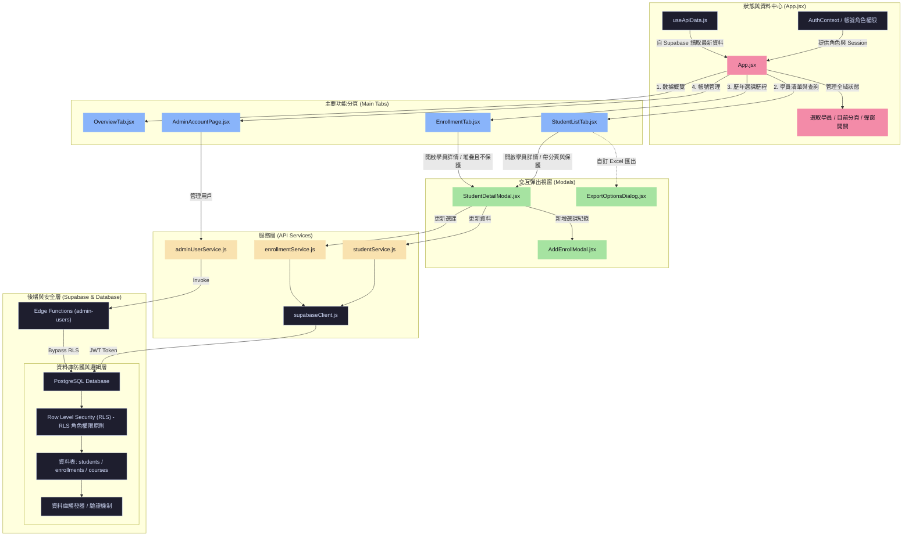
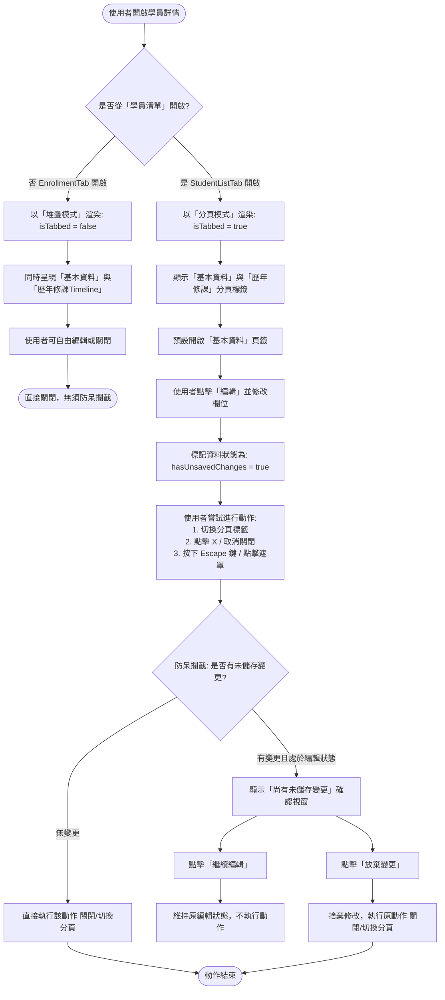

# YMCA 學員資訊管理系統 - 技術選型、系統架構與業務邏輯說明書

本文件詳細闡述本系統的技術選型與原因、整體軟體架構、資料流，以及三大核心業務邏輯的實作細節，並附帶對應的 Mermaid 流程與結構圖。

---

## 一、 技術選型與原因分析 (Tech Stack Selection & Rationale)

本系統作為 YMCA 樂齡健康活力中心內部行政後台，主要處理學員資料、歷年選課紀錄追蹤及數據分析。在技術選型上，首要考量為**高開發效率、系統穩定性、低營運維護成本與強資料一致性**。

| 層級 (Layer) | 選用技術 (Selected Technology) | 選定原因與商業價值 (Rationale & Value) |
| :--- | :--- | :--- |
| **前端框架** | **React 19 + Vite** | 1. **React 19** 提供了更精簡的渲染與 API。單頁應用程式 (SPA) 的架構能提供極佳的行政人員操作體驗。 2. **Vite** 作為建置工具，具備極速的熱模組替換 (HMR) 與開箱即用的 ESM 支援，大幅提升本機開發與測試的速度。 |
| **樣式與 UI** | **Tailwind CSS 3 + Base UI + shadcn/ui** | 1. **Tailwind CSS** 提供原子化類別，便於微調 UI 並減少編譯後的 CSS 體積。 2. **Base UI / shadcn/ui** 提供無樣式、符合無障礙規範 (ARIA) 的基礎元件（例如對話框、選單），確保鍵盤操作與螢幕閱讀器友善，同時保有高度 CSS 自訂靈活度。 |
| **後端與資料庫** | **Supabase (PostgreSQL / Auth / Edge Functions)** | 1. **PostgreSQL** 具備強大的關聯式資料庫約束（Foreign Keys, Unique Constraints），完美保障學員與選課的關聯一致性。 2. **Supabase Auth** 提供現成的使用者認證，結合 PostgreSQL 的 **Row Level Security (RLS)** 機制，可直接在資料庫層限制不同角色的讀寫權限（`admin`, `editor`, `viewer`）。 3. **Edge Functions (Deno)** 可用於執行特權管理邏輯，如 admin 的帳號邀請、刪除與稽核日誌記錄，無須維護笨重的後端伺服器，大幅降低維運開銷。 |
| **資料處理** | **SheetJS (xlsx)** | YMCA 的原始學員報名資料多以 Excel 儲存。採用 **SheetJS** 可以在前端直接解析上傳的 Excel/CSV 檔案，並在本地端將複雜關聯資料（統計、個人資料、選課歷史）直接封裝成包含多個工作表 (Sheets) 的 Excel 檔下載，減少伺服器運算負載。 |
| **自動化測試** | **Vitest + React Testing Library** | 1. **Vitest** 深度整合 Vite，共用相同的配置檔與編譯器，執行單元測試速度極快。 2. **React Testing Library** 著重於使用者行為的測試而非內部實作，結合 jsdom 模擬瀏覽器環境，保障前端 UI 邏輯與 API 服務的正確性（本專案已包含 240+ 個自動化測試）。 |
| **程式碼檢查** | **Oxlint** | 採用 Rust 編寫的超高速 JavaScript/JSX Linter，可在幾毫秒內掃描整份專案，比傳統 ESLint 快上百倍，能即時在開發或 commit 前發現語法錯誤與潛在 Bug。 |

---

## 二、 系統架構與資料流 (System Architecture & Data Flow)

本系統採取**分層架構 (Layered Architecture)**，強調「介面與狀態分離」、「商業邏輯與外部框架解耦」的原則。前端分為四個主要層次：

1. **元件層 (UI Components)**：負責視覺呈現，不直接調用 Supabase，改由 Hooks 或 Services 取得資料。
2. **Context 與狀態層 (Context & Custom Hooks)**：
   - [AuthContext.jsx](file:///C:/Users/user/Desktop/work/dashboard/src/contexts/AuthContext.jsx) 儲存當前使用者的登入 Session 與系統角色權限。
   - 自訂 Hooks（如 [useApiData.js](file:///C:/Users/user/Desktop/work/dashboard/src/hooks/useApiData.js)、[useStudentSelection.js](file:///C:/Users/user/Desktop/work/dashboard/src/hooks/useStudentSelection.js)、[useUnsavedChangesGuard.js](file:///C:/Users/user/Desktop/work/dashboard/src/hooks/useUnsavedChangesGuard.js)）抽離頁面狀態與跨元件邏輯。
3. **服務層 (API Services)**：封裝 Supabase Client API 調用。例如 [studentService.js](file:///C:/Users/user/Desktop/work/dashboard/src/services/studentService.js)、[enrollmentService.js](file:///C:/Users/user/Desktop/work/dashboard/src/services/enrollmentService.js)、[adminUserService.js](file:///C:/Users/user/Desktop/work/dashboard/src/services/adminUserService.js)，負責與後端資料庫及 Edge Functions 進行資料交換。
4. **領域與純邏輯層 (Domain / Pure Logic)**：完全不依賴 React 或 Supabase 的純 JavaScript 工具與計算邏輯。例如 [excelImport.js](file:///C:/Users/user/Desktop/work/dashboard/src/domain/excelImport.js)、[quarterCsvImport.js](file:///C:/Users/user/Desktop/work/dashboard/src/domain/quarterCsvImport.js) 及 [studentIdentity.js](file:///C:/Users/user/Desktop/work/dashboard/src/domain/studentIdentity.js)，確保核心演算法（例如身分識別、資料清洗）能在無瀏覽器/無網路環境下獨立進行單元測試。

### 系統組件與資料流架構圖

此圖展示了前端應用程式的階層關係、全域狀態、API 資料流向以及後端資料庫的防護網。

---

## 三、 核心技術細節與業務邏輯流程 (Technical Details & Business Flows)

### 1. 編輯變更防呆攔截機制 (Edit Protection / Unsaved Changes Guard)

在行政後台操作中，常有使用者不小心點擊遮罩關閉視窗、按到 `Escape` 鍵，或是切換分頁而導致輸入一半的學員表單遺失的問題。本系統透過 [useUnsavedChangesGuard.js](file:///C:/Users/user/Desktop/work/dashboard/src/hooks/useUnsavedChangesGuard.js) 提供攔截機制：

- 當使用者在編輯表單（[StudentEditForm.jsx](file:///C:/Users/user/Desktop/work/dashboard/src/components/students/StudentEditForm.jsx)）中修改任何欄位時，觸發 `setHasUnsavedChanges(true)`。
- 此時使用者的任何「離開動作」（包含：點擊 modal 關閉按鈕、點擊背景遮罩、按下 ESC 鍵、或是點擊 Tab 切換基本資料與歷年修課）都不會立刻執行，而是先被包裝成 `pendingAction`。
- 系統彈出警告視窗（`ConfirmDialog`）提示「尚有未儲存變更，離開後本次修改將不會保留」。
- 使用者點擊「放棄變更」時，才真正呼叫並執行 `pendingAction()`；點擊「繼續編輯」則清除 `pendingAction` 並保留原編輯畫面。

#### 編輯保護流程圖

---

### 2. Excel 匯出與中文化轉譯機制 (Excel Export & Chinese Mapping)

為提供 YMCA 行政人員能產出符合主事機關與內部統計所需的統計格式，系統實作了 Excel 的客製化匯出模組 [excelExport.js](file:///C:/Users/user/Desktop/work/dashboard/src/lib/excelExport.js)：

- **權限限制**：僅限具有 `admin` 角色的使用者才可看到與點擊「下載整理版 Excel」按鈕。
- **過濾與篩選**：允許使用者選擇特定季度期別（如「第十一季」）或選擇「全部匯出」，並能透過 Checkbox 勾選要產出哪些工作表。
- **資料轉換與中文化**：
  - **學員個人資料**：排除系統建立的時間戳記（`created_at`, `updated_at`），並將欄位對照轉譯為傳統中文（如 `student_id` -> 「學員編號」, `name` -> 「姓名」）。
  - **選課明細紀錄**：展開 enrollments 關聯，並自動統計學員在該期別選修的所有課程，合併為「課程選修」欄位。
  - **統計摘要與課程統計**：自動依性別、年齡（是否滿 60 歲以上）、學歷、職業分佈進行交叉分析計算，並動態生成一份獨立的工作表，行政人員可直接以此向主管機關進行簡報。

#### Excel 匯出流程圖

---

### 3. 學員編號重組與身分識別比對機制 (Student ID Reconciliation & CSV Import)

此為系統最複雜且至關重要的商業邏輯。YMCA 在每季課程結束導入 CSV/Excel 資料時，檔案中的「學員編號」可能未填（即空白欄位）。為了避免重複建立學員，並在改號時維護資料完整性，系統採取了前端驗證與後端資料庫交易鎖定的雙重防護機制：

#### (1) 學員編號 (Student ID) 正規化規則
- 手動輸入、CSV 指定的 ID 必須符合大於 0 的正整數，排除前導零（例如將 `0012` 正規化為 `12`）。
- 資料庫層級透過觸發器 [20260723120000_student_id_reconciliation.sql](file:///C:/Users/user/Desktop/work/supabase/migrations/20260723120000_student_id_reconciliation.sql) 中的 `students_enforce_student_id` 觸發器進行強制檢驗。
- 既有系統中的非數字舊 ID（例如歷史遺留字串）仍被允許唯讀與更新其他欄位，但一旦要修改 ID 本身，則必須改為正整數格式。

#### (2) 空白 ID 的三欄身分比對鍵 (Unique Identity Key)
當 CSV 中的學員編號欄位為**空白**時，資料庫 RPC 函數 `import_season_data` 將使用以下三欄組合為身分識別鍵：
$$\text{身分鍵} = (\text{姓名}) + (\text{性別}) + (\text{出生日期 YYYY/MM/DD})$$
- **唯一符合**：若此三欄與資料庫內某一學員完全一致，則系統將此列資料識別為「既有學員更新」，並使用該學員的既有 ID。
- **無符合者**：若資料庫查無此人，則判定為「新增學員」，系統會自動進行**自動配號**（目前資料庫中最大數字 ID + 1）。
- **多人符合（衝突）**：若有兩位以上學員的三欄資料相同，系統將拋出 `AMBIGUOUS_STUDENT_MATCH` 錯誤，並復原（Rollback）整筆匯入交易，避免錯誤合併。
- **同檔案重複**：同一個 CSV 檔中若有兩列空白 ID 的學員填寫了完全相同的三欄資訊，系統會視為檔案內容異常，拒絕匯入。

#### (3) 交易安全與外鍵級聯 (Transaction Lock & Cascade Update)
- 在資料庫內執行匯入時，RPC 會先調用 `pg_advisory_xact_lock(hashtext('public.student_identity_mutation'))`，進行資料庫交易鎖定。這能防止多名行政人員同時匯入時拿到重複的「最大 ID + 1」造成寫入衝突。
- `enrollments` 與 `students` 的關聯外鍵限制設為 `ON UPDATE CASCADE`。當行政人員在手動修改某學員的 ID 時（例如將 `99` 改為 `100`），該學員所有歷年選課紀錄（`enrollments`）中的 `student_id` 會同步在同一筆資料庫交易內完成改號，完美維護關聯完整性。

#### 學員身分比對與 CSV 匯入流程圖

